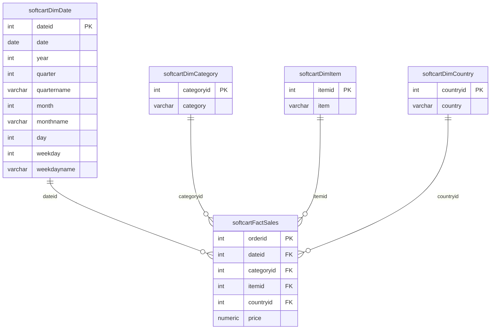

# Module 3 — Data Warehouse (PostgreSQL)

**Scenario:** SoftCart wants reports such as total sales per year per country, per month per category, per quarter per country, and per category per country. The OLTP database is the wrong tool for this, so I designed and built a star-schema warehouse.

## Part 1 — Design the star schema



**How I made the design choices**

1. **Grain first:** one fact row per order. Everything else follows from that.
2. **The only measure is `price`.** Everything a report groups or filters by becomes a dimension: date, category, item, country.
3. **Date dimension at day level** with year, quarter, month, weekday and their names already computed. Reports then never call date functions, they just `GROUP BY year, quarter`.
4. **One-to-many relationships** from every dimension to the fact table, enforced with foreign keys.

DDL: [`design/softcart_schema.sql`](design/softcart_schema.sql) · created in a database named `staging` (Task 7).

## Part 2 — Reporting

The senior data engineer refined my design into `DimDate`, `DimCategory`, `DimCountry`, `FactSales` (300,000 orders).

| Task | Query | File |
|------|-------|------|
| 1–4 | Load 4 CSVs, preview 5 rows each | [`reporting/02_load_data.sql`](reporting/02_load_data.sql) |
| 5 | `GROUPING SETS` — country, category, total sales | [`reporting/03_reporting_queries.sql`](reporting/03_reporting_queries.sql) |
| 6 | `ROLLUP` — year → country, total sales | same file |
| 7 | `CUBE` — year × country, average sales | same file |
| 8 | MQT `total_sales_per_country` (materialized view) | same file |

**GROUPING SETS vs ROLLUP vs CUBE in one line each**

- `GROUPING SETS` — you list exactly which groupings you want.
- `ROLLUP(a, b)` — hierarchical subtotals: `(a,b)`, `(a)`, `()`. Good for year → country drill-downs.
- `CUBE(a, b)` — every combination: `(a,b)`, `(a)`, `(b)`, `()`.

Rows with `NULL` in a grouping column are the subtotal rows.

**Why a materialized view?** Total sales per country is asked for constantly but changes only once a day. Storing the result means the dashboard reads 56 rows instead of aggregating 300,000; `REFRESH MATERIALIZED VIEW` after each nightly load keeps it current.

## Run it

```bash
./run.sh     # creates "staging" and "Test1" in the local Docker PostgreSQL
```
