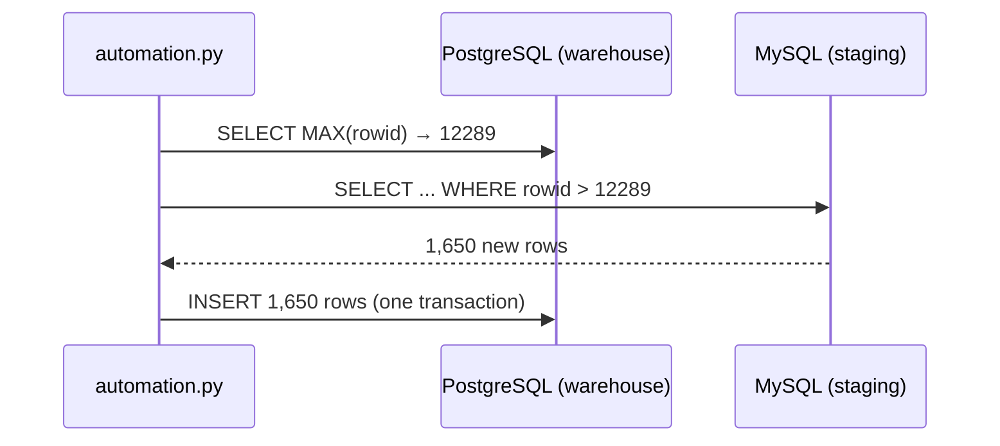
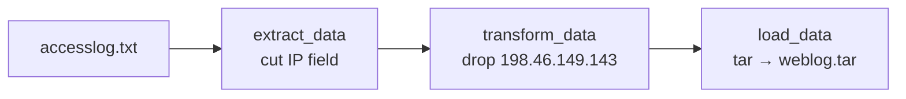

# Module 5 — ETL & Data Pipelines

## Part 1 · Incremental ETL with Python (MySQL → PostgreSQL)

**Scenario:** New sales arrive in the MySQL staging database every day. The PostgreSQL production warehouse must receive them without reloading everything.



| Task | Function | What it does |
|------|----------|--------------|
| 1 | `get_last_rowid()` | High-water mark: `MAX(rowid)` in the warehouse |
| 2 | `get_latest_records(rowid)` | Only the MySQL rows above that mark |
| 3 | `insert_records(records)` | Batched insert with `execute_values`, committed once |
| 4 | Run `automation.py` | Verify the sync |

Code: [`etl/automation.py`](etl/automation.py) · warehouse setup: [`etl/setup_postgres.sql`](etl/setup_postgres.sql)

**Design choices**

- **High-water mark instead of full reload:** reads only new rows, so runtime grows with daily volume, not total history.
- **Idempotent:** the mark is re-read every run, so running twice never duplicates rows (run 2 reports 0 new rows). The primary key on `rowid` is a second safety net.
- **One transaction:** if anything fails mid-insert, nothing is committed and the next run simply retries.
- **No credentials in code:** connection settings come from environment variables.

**Expected output**

```
Last row id on production datawarehouse =  12289
New rows on staging datawarehouse =  1650
New rows inserted into production datawarehouse =  1650
```

Run locally (after `make up`): `./run_etl.sh` — note this recreates the MySQL `sales` database from `sales.sql`.

## Part 2 · Airflow DAG `process_web_log`

**Scenario:** The web server log must reach the big data platform daily, in a cleaned form.



| Task | What | Where |
|------|------|-------|
| 1–2 | DAG arguments (owner, start_date, email) and daily DAG | [`airflow/process_web_log.py`](airflow/process_web_log.py) |
| 3–5 | `extract_data`, `transform_data`, `load_data` BashOperators | same file |
| 6 | Pipeline `extract_data >> transform_data >> load_data` | same file |
| 7–9 | Submit, unpause, monitor | [`airflow/commands.sh`](airflow/commands.sh) |

**Detail worth noticing:** the filter uses `grep -vxF`. `-F` treats the dots in the IP literally (in a regex `.` matches any character) and `-x` matches the whole line, so `198.46.149.1430` would not be removed by accident.

Run locally: `make airflow`, open http://localhost:8080 (the admin password is printed in `docker logs softcart-airflow`), unpause `process_web_log`.
