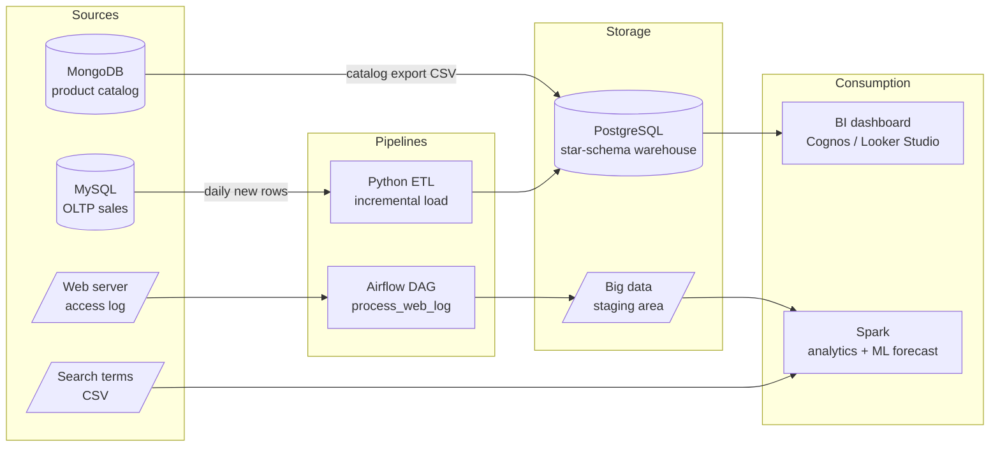

# SoftCart Data Platform — End-to-End Data Engineering Project

> Capstone of the **IBM Data Engineering Professional Certificate** (Coursera).
> I play a junior data engineer at **SoftCart**, a fictional global e-commerce company, and build its analytics platform from the transactional database all the way to dashboards and ML predictions.


---

## The business problem

SoftCart sells products online to customers worldwide. Its data is scattered:

- **Sales transactions** land in an operational MySQL database.
- **The product catalog** (laptops, phones, TVs with varying attributes) lives in MongoDB.
- **Web server logs** and **search terms** pile up as raw files.

Management wants yearly / monthly / quarterly sales reports by country and category, a live dashboard, and a sales forecast. This project builds the platform that makes that possible.

## Architecture



## What's in each module

| # | Module | What I built | Key skills |
|---|--------|--------------|------------|
| 1 | [OLTP database](01-oltp-mysql/) | `sales` schema in MySQL, bulk load, timestamp index, automated backup script | DDL, indexing, `mysqldump`, Bash |
| 2 | [NoSQL catalog](02-nosql-mongodb/) | `catalog.electronics` collection, index, analytical queries, CSV export | `mongoimport`/`mongoexport`, aggregation pipeline |
| 3 | [Data warehouse](03-data-warehouse/) | Star schema design (ERD) + reporting with `GROUPING SETS`, `ROLLUP`, `CUBE` and a materialized view | Dimensional modelling, OLAP SQL |
| 4 | [Dashboard](04-dashboard/) | Sales dashboard: monthly trend, category split, quarterly mobile sales | BI, data storytelling |
| 5 | [ETL & pipelines](05-etl-pipelines/) | Python incremental sync MySQL → PostgreSQL; Airflow DAG for web-log processing | Python DB-API, idempotent loads, Airflow |
| 6 | [Big data & ML](06-spark-analytics/) | Spark analysis of 10k search terms; load a pretrained SparkML model and forecast sales | PySpark, SparkML model ops |

## Run it locally

The course runs each lab in a throwaway IBM cloud IDE. I added a **Docker Compose** setup so the whole platform runs on any laptop.

```bash
git clone https://github.com/hongan1906/softcart-data-platform.git
cd softcart-data-platform
cp .env.example .env               # set your own passwords
make data                          # downloads the course datasets into ./data
make up                            # starts MySQL, MongoDB, PostgreSQL
make airflow                       # optional: starts Airflow on http://localhost:8080
```

Then follow the README inside each module folder, in order. Every module has a `run.sh` that executes the full module end to end.

Requirements: Docker + Docker Compose, Python 3.10+, `make`. Python packages: `pip install -r requirements.txt`.

## Results at a glance

| Question | Answer |
|----------|--------|
| Rows loaded into the OLTP `sales_data` table | 2,605 |
| Laptops in the catalog | 389 |
| Average smartphone screen size | 6.0 in |
| Times "gaming laptop" was searched | 499 |
| Most searched term | "mobile 6 inch" (2,312) |
| New rows synced by the ETL job | 1,650 |

_Full outputs are in each module's `outputs/` folder and screenshots are in [`docs/screenshots`](docs/screenshots/)._

## Repository layout

```
softcart-data-platform/
├── 01-oltp-mysql/          # schema, load, admin tasks, backup script
├── 02-nosql-mongodb/       # import, queries, export
├── 03-data-warehouse/
│   ├── design/             # star schema DDL + ERD
│   └── reporting/          # load + OLAP queries + materialized view
├── 04-dashboard/           # dashboard spec + Python chart reproduction
├── 05-etl-pipelines/
│   ├── etl/                # automation.py incremental sync
│   └── airflow/            # process_web_log DAG
├── 06-spark-analytics/     # search-term analysis + sales forecast
├── docs/screenshots/       # evidence for each lab
├── scripts/                # data download helper
├── docker-compose.yml
└── Makefile
```

## What I learned

- **Where each storage technology fits.** OLTP is optimised for many small writes; the warehouse is optimised for big aggregations; document stores fit catalogs whose products have different attributes.
- **Dimensional modelling.** Picking the grain (one row per order line) first makes every other design decision easier.
- **Incremental loads.** Syncing only rows above the warehouse's high-water mark (`MAX(rowid)`) keeps the daily job fast and safe to re-run.
- **Orchestration.** An Airflow DAG turns a set of shell commands into a scheduled, monitored, retryable pipeline.

## About me

I'm An Truong, a supply chain and procurement professional (Schneider Electric, KONE, Mitsubishi Logisnext) building data engineering skills on top of operations experience. Based in Helsinki.
**YADA — Yet An-other Data Anthusiast.**

---
<sub>Datasets are synthetic and provided by IBM Skills Network for this course.</sub>
